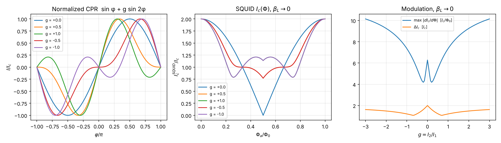
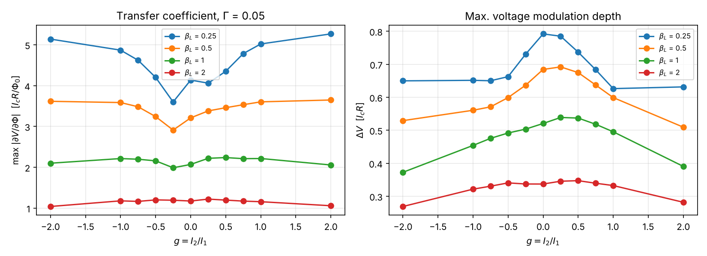
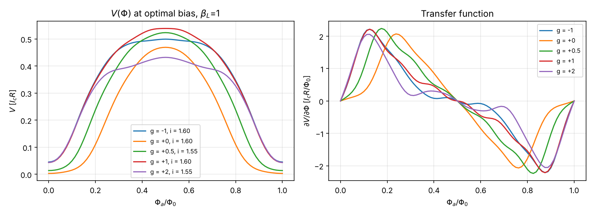
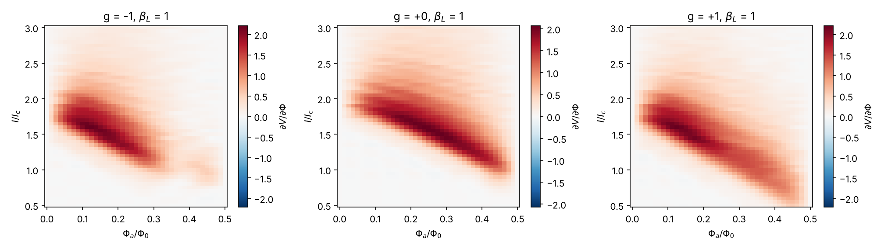

# Enhancing quantum sensing in SQUIDs with second-harmonic Josephson junctions

A dc SQUID (Superconducting Quantum Interference Device) is a superconducting
loop interrupted by two Josephson junctions. It converts magnetic flux into
voltage. Its key figure of merit is the **flux-to-voltage transfer coefficient**

    V_Φ = max |∂V/∂Φ|   (over bias current and working-point flux)

A larger V_Φ means a more sensitive sensor, and it also makes the amplifier noise of
the readout electronics less important.

This repository asks one question: can junctions whose current-phase relation
(CPR) has a **second harmonic**,

    I(φ) = I₁ sin φ + I₂ sin 2φ,     g ≡ I₂ / I₁,

give a larger V_Φ than conventional tunnel junctions (g = 0)? It answers that
question with numerical simulations.

## Model

Each junction is modelled as an overdamped resistively shunted junction with an
arbitrary CPR f(φ), and the junctions are placed in the standard Tesche–Clarke
dc-SQUID equations ([`squid/dynamics.py`](squid/dynamics.py)):

    dφ₁/dτ = i/2 − j − f(φ₁) + i_n1
    dφ₂/dτ = i/2 + j − f(φ₂) + i_n2
    φ₁ − φ₂ = 2π Φ_a/Φ₀ + π β_L j

* Units: currents are in I_c, voltages in I_c R, and τ = 2π I_c R t / Φ₀.
  The screening parameter is β_L = 2 L I_c / Φ₀.
* Thermal noise of the shunts has ⟨i_n(τ) i_n(τ')⟩ = 2Γ δ(τ−τ'), with
  Γ = 2π k_B T / (I_c Φ₀). All results use Γ = 0.05, a typical value for
  low-T_c SQUIDs at 4.2 K.
* **Fair comparison.** Adding sin 2φ changes a junction's true critical current.
  Every CPR is therefore normalized to max f = 1
  ([`squid/cpr.py`](squid/cpr.py)). All SQUIDs compared here have the same
  junction I_c, R, I_cR, loop inductance L, β_L and Γ. Only the shape of the
  CPR differs.
* **Numerics.** The equations are solved on the whole bias × flux grid at once
  with a stochastic Heun scheme. All grid points share the same noise
  (common random numbers), and the results are averaged over 8 independent
  realizations. ∂V/∂Φ comes from a least-squares fit of V(Φ) to an 8-harmonic
  cosine series that is then differentiated. This avoids the upward bias of
  taking the maximum of a noisy finite difference.

### Validation (`tests/`)

* The normalized CPR has a maximum of 1, and its critical current matches the
  closed form.
* For g = 0 and β_L → 0, I_c(Φ) = 2|cos πΦ/Φ₀|, and the RSJ result
  v = √((i/2)² − 1) is reproduced.
* The time-domain simulation agrees with the exact β_L → 0, Γ = 0 solution
  v = 2π / ∮dφ/(i/2 − F(φ)) to better than 5·10⁻³ I_cR, for several values of g.
* A conventional SQUID with β_L = 1 and Γ = 0.05 gives V_Φ ≈ 2.07 I_cR/Φ₀ = R/L.
  This is the classic Tesche–Clarke value.

## Results

Run with `python scripts/run_study.py`. It takes about 12 minutes on 4 cores and
writes [`results/vphi_sweep.csv`](results/vphi_sweep.csv) and the figures in
`figures/`.

### 1. Critical-current modulation (β_L → 0, analytic)



For small β_L the SQUID behaves like one junction with the effective CPR

    F(φ) = cos(πΦ/Φ₀) sin φ + g cos(2πΦ/Φ₀) sin 2φ   (up to normalization)

The two harmonics are modulated with periods Φ₀ and Φ₀/2. This has three
consequences:

* I_c(Φ) no longer drops to zero at Φ₀/2, because the sin 2φ term survives
  there. The modulation depth ΔI_c falls from 2 I_c to about 1.1–1.6 I_c.
* I_c(Φ) has a much steeper slope at Φ ≈ 0.2 Φ₀. For |g| ≳ 1,
  max |dI_c/dΦ| goes up to 7–10 I_c/Φ₀, compared with 2π for g = 0.
* At β_L → 0 the I_c(Φ) curves are identical for +g and −g.

### 2. Transfer coefficient with noise and screening (Γ = 0.05)



V_Φ relative to the conventional SQUID (g = 0) at the same β_L:

| β_L  | g = −2 | g = −1 | g = −0.5 | g = 0 | g = +0.5 | g = +1 | g = +2 |
|------|-------:|-------:|---------:|------:|---------:|-------:|-------:|
| 0.25 | 1.24   | 1.18   | 1.02     | 1     | 1.05     | 1.21   | **1.27** |
| 0.5  | 1.13   | 1.12   | 1.01     | 1     | 1.08     | 1.12   | **1.14** |
| 1    | 1.01   | 1.07   | 1.04     | 1     | **1.08** | 1.07   | 0.99   |
| 2    | 0.89   | 1.00   | 1.02     | 1     | 1.02     | 0.99   | 0.90   |

Repeating runs with different noise seeds changes V_Φ by roughly ±5 %. Treat
differences below about 5 % as not significant.




### Findings

1. **A second harmonic increases V_Φ, but only in SQUIDs with small screening.**
   * β_L = 0.25: V_Φ is up to 27 % higher for |g| = 1–2.
   * β_L = 0.5: about 12–14 % higher.
   * β_L = 1: only a marginal gain, about 7 % (g ≈ 0.25–1), close to the
     statistical error.
   * β_L = 2: no gain, and a loss at large |g|.
2. **The mechanism is the steeper slope of I_c(Φ)**, not a larger modulation
   depth. The voltage swing ΔV actually drops by 10–25 %. The optimal working
   point moves from Φ ≈ 0.25–0.3 Φ₀ to Φ ≈ 0.12–0.16 Φ₀. V(Φ) becomes
   asymmetric within each half period: a steep flank near integer flux and a
   flat plateau around Φ₀/2. A flux-locked loop has to be biased on the steep
   flank.
3. **Why the gain disappears at larger β_L.** Screening currents in the loop
   smooth out sharp features in I_c(Φ), and the loop inductance caps the
   transfer coefficient at V_Φ ≲ R/L. Once the loop is inductance-limited
   (β_L ≳ 1), the CPR shape barely matters.
4. **Too much second harmonic hurts.** Above |g| ≈ 1–2, the shrinking
   modulation depth starts to outweigh the steeper slope. The best range is
   |g| ≈ 1–2 for β_L ≲ 0.5, and |g| ≈ 0.5 for β_L ≈ 1. The sign of g matters
   little: it is irrelevant at β_L → 0, and in the simulations the differences
   between +g and −g are within or near the statistical error.
5. **Design implication.** The best use of second-harmonic junctions is in
   **low-inductance SQUIDs** (β_L ≈ 0.25–0.5), for example nanoSQUIDs, with
   |I₂/I₁| ≈ 1. These are the devices where junction physics, rather than
   the loop inductance, sets V_Φ. Absolute V_Φ is also highest for small β_L
   (≈ 5 I_cR/Φ₀ at β_L = 0.25 compared with ≈ 2 at β_L = 1). Because the
   comparison is at fixed I_c, the gain appears directly as a larger
   flux-to-voltage conversion.

### Limitations and next steps

* The only figure of merit computed is V_Φ. The actual sensitivity is set by
  the flux-noise spectral density S_Φ = S_V / V_Φ². The next step is to
  compute S_V from the same simulations, because the changed shape of V(Φ)
  also changes the voltage noise.
* The model assumes overdamped junctions (β_c = 0), a symmetric SQUID and white
  Nyquist noise. Junction asymmetry, capacitance (β_c ≳ 0.5), and the different
  intrinsic noise and I_cR products of real SFS, d-wave or ballistic junctions
  are not included.
* Larger grids, finer bias steps and more noise realizations would reduce the
  ±5 % statistical error. Raise `n_realizations` and `t_avg` in
  `scripts/run_study.py`.

## Usage

```bash
pip install -r requirements.txt
python -m pytest -q                    # validation tests (~15 s)
python scripts/run_study.py --quick    # smoke run (~20 s)
python scripts/run_study.py            # full study (~12 min, 4 cores)
```

```python
import numpy as np
from squid import CPR, squid_transfer

r = squid_transfer(CPR.second_harmonic(1.0), beta_L=0.25, gamma=0.05,
                   i_bias=np.linspace(1.0, 2.0, 21), n_realizations=8)
print(r.v_phi_max, r.i_opt, r.phi_opt)   # V_Φ in I_cR/Φ₀, optimal bias and flux
```
